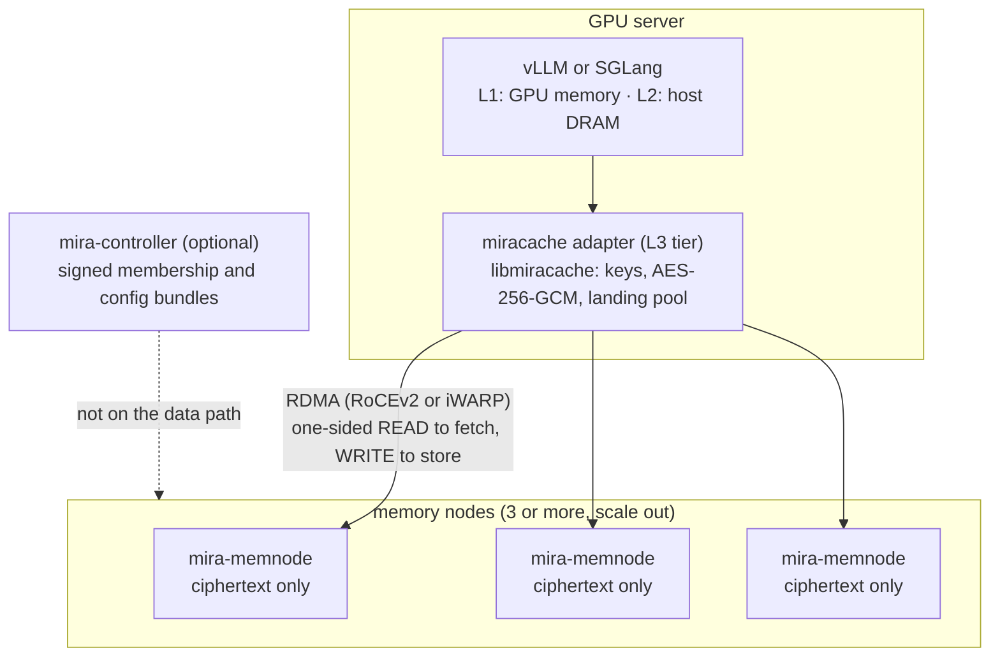

<h1 align="center">miracache</h1>

<p align="center">
  <b>A remote KV-cache tier for LLM inference.</b><br>
  Pool the DRAM of ordinary x86 servers over RDMA, and serve conversation state back to vLLM and SGLang<br>
  instead of recomputing it.
</p>

<p align="center">
  <a href="https://github.com/mirastacklabs-ai/miracache/actions/workflows/ci.yml?query=branch%3Amain"></a>
  <a href="https://github.com/mirastacklabs-ai/miracache/releases"></a>
  <a href="LICENSE"></a>
  
  
  
</p>

<p align="center">
  <a href="https://mirastacklabs.ai">
    <picture>
      <source media="(prefers-color-scheme: dark)" srcset="assets/mirastack-labs-logo-dark.png">
      
    </picture>
  </a>
</p>

---

> **Status: alpha.** The whole system is built: memory server, controller, client library, the vLLM and SGLang
> plug-ins, host checks, systemd units, Docker images, dashboards and alerts. It is tested end to end on
> **software RDMA** (soft-RoCE and soft-iWARP); the engine plug-ins are contract-tested against the pinned engines
> (import only): no engine has served requests through miracache on a GPU yet. Validation on hardware NICs and GPU
> serving runs are in progress. **No performance figures are published yet**: nothing on this page is a benchmark of
> miracache.

## Why

An LLM answers in two phases. **Prefill** reads the whole prompt and builds the model's attention state for every
token, the **KV cache**. **Decode** then writes the answer one token at a time. For long prompts, prefill dominates the
time to first token (TTFT).

If the KV cache of a conversation is kept, the next turn only processes the new tokens. If it is lost, the GPU
recomputes the whole history before it can answer. And it is lost all the time:

- **It is big.** At FP8, one 128K-token conversation takes about 5–17 GB of KV on today's large open models (computed
  from their published configurations: e.g. 12.6 GB for Qwen3-235B, 4.6 GB for Kimi-K2.5). A GPU server holds the KV of
  only a handful of such conversations next to the model weights.
- **Agents make it worse.** Coding agents resend a ~120K-token prefix at every step and reuse ~96% of it, with pauses
  for tool calls and human think-time long enough for the cache to be evicted
  (TraceLab study of 4,265 agent sessions, arXiv 2606.30560).
- **Moving a session loses it.** When a gateway re-pins a session to another GPU (drain, failure, rebalancing), the
  engine's own GPU and host caches are left behind on the old server.

miracache keeps that state in a shared pool of cheap DRAM, so a cache miss on the GPU becomes a fetch over RDMA
instead of a full recompute.

## What it is



- **Memory nodes** (`mira-memnode`) are ordinary x86 servers full of DRAM, for example the DDR4 fleets data centres
  are retiring. They store KV blocks in large pinned hugepage regions and never see a key: they hold ciphertext only.
- **GPU servers** load miracache into the engine as an **L3 tier**, below the engine's own GPU (L1) and host-DRAM (L2)
  caches. When the engine misses, miracache looks the blocks up, pulls them with a one-sided RDMA READ, checks them and
  decrypts them into the engine's buffer. When the engine evicts a block, miracache encrypts it and stores it.
- **The controller** (`mira-controller`, with the `mirctl` CLI) builds and signs membership and configuration bundles
  for larger clusters. It is optional and never on the data path; a small cluster runs from a static node list.

## Highlights

| | |
|---|---|
| **Built to plug into vLLM and SGLang** | vLLM through its tiering API (`MiraTier`), SGLang through its HiCache `dynamic` storage backend (`MiraHiCacheStorage`). No engine patches; it needs specific engine flags, which `mira-preflight` checks |
| **Standard RoCEv2 and iWARP** | Both RDMA flavours through the standard Linux connection manager (`rdma_cm`), one code path, auto-detected, multiple rails per host |
| **Encrypted end to end** | KV is encrypted and authenticated (AES-256-GCM) on the GPU host before it leaves. Memory nodes are treated as untrusted: they hold no keys, and every fetch is verified |
| **Engine-equivalent isolation** | miracache never shares KV between two requests that the engine would not share in its own prefix cache (vLLM `cache_salt`, SGLang `extra_key`) |
| **Exact bytes or a miss** | Leases, a commit fence on every store, a generation check after every read and the AEAD tag together guarantee that a fetch returns exactly what was stored, or reports a miss. A miss only costs a recompute |
| **Scale out** | Three or more memory nodes, deterministic placement, no data movement when a node joins; losing a node costs about 1/N of the cache. Optional replicas keep a second copy |
| **Live operations** | Configuration, certificates and keys reload without a restart; a restarted memory node keeps its cache |
| **Least privilege** | Memory nodes run as an unprivileged user with `CAP_IPC_LOCK` only, under systemd or in Docker |
| **Observable** | Prometheus metrics, Grafana dashboards and alert rules; every log line and metric about a memory node carries its ID, hostname and IP |

## How a fetch and a store work

**Fetch** (the engine asks for blocks it does not have):

1. **LOOKUP** on the memory node that owns the blocks. It answers with their locations and a short **lease**, a
   promise that the blocks will not be moved or overwritten while they are read.
2. **RDMA READ** of the ciphertext straight from the node's memory into the client's landing pool, across all rails.
   The node's CPU does no work for this.
3. **Verify**: re-read the block's generation word (unchanged means the bytes were stable during the read), then check
   every segment's AES-GCM tag, and decrypt into the engine's buffer.
4. Report a **hit** only if both checks pass; otherwise a **miss**, and the engine recomputes.

**Store** (the engine offers blocks to keep): the client asks the node for space (`PUT_BEGIN`), encrypts only the
accepted blocks, writes them with RDMA WRITE, and commits with a checksum (`PUT_COMMIT`). The node fences the write
window, re-checks the checksum and only then makes the block visible.

The protocol was model-checked (Rust, Stateright) before the data path was written, and the code runs under a
deterministic fault-injection simulator, fuzzers, sanitizers and golden wire-format vectors.

## Status

| Built and tested on software RDMA | Not yet |
|---|---|
| Memory server, controller, client library (C++ API, C ABI, Python binding) | Validation on hardware NICs (Intel E810, Chelsio, NVIDIA ConnectX) |
| vLLM and SGLang plug-ins, contract-tested against vLLM 0.33.0 and SGLang 0.5.23 (import only, no GPU) | Serving runs with a real engine on GPUs |
| End-to-end RDMA suite on soft-RoCE and soft-iWARP; three memory nodes under systemd and in Docker, zero errors | Any performance figure: TTFT, throughput, latency, cost |
| Live reload under load, rolling restarts keeping the cache, optional replicas | Long soak runs and a hardware lab matrix |

## Requirements

| Role | Needs |
|---|---|
| Memory node | x86-64 Linux (tested on Ubuntu 24.04), an RDMA NIC speaking RoCEv2 or iWARP (or soft-RoCE / soft-iWARP for trials), hugepages, plenty of DRAM. Three or more nodes |
| GPU host | vLLM 0.32–0.34 (accepted range; contract-tested at 0.33.0) or SGLang 0.5.23 (contract-tested), Python 3.10+, the same RDMA fabric as the memory nodes |
| Build | clang-18, CMake 3.28+, Ninja, rdma-core (`libibverbs-dev`, `librdmacm-dev`), OpenSSL (`libssl-dev`). Go is fetched and checksum-verified by `deploy/docker/go.sh` |

## Build and test it yourself

Everything we test is in this repository. On Ubuntu 24.04:

```sh
sudo apt-get install -y clang-18 clang-tools-18 libclang-rt-18-dev cmake ninja-build pkg-config \
  libibverbs-dev librdmacm-dev libssl-dev python3 golang
git clone https://github.com/mirastacklabs-ai/miracache && cd miracache

cmake --preset release -DMIRACACHE_SIM=OFF && cmake --build --preset release
ctest --preset release -j"$(nproc)"                                  # C++ unit, integration, golden tests
(cd controller && go vet ./... && go test -race ./...)               # controller and mirctl (Go 1.22+)
PYTHONPATH=python python3 -m unittest discover -s tests/python       # Python adapters and tools
```

- **Sanitizers:** the `asan` and `tsan` presets build and test the same way (`cmake --preset tsan` ...). On Ubuntu
  24.04, ThreadSanitizer needs `sudo sysctl vm.mmap_rnd_bits=28` first.
- **Deterministic simulator:** the `sim` preset runs the whole cluster in one process with injected faults (crashes,
  drops, delays) across thousands of seeds; any failing seed replays exactly. See [docs/simulator.md](docs/simulator.md).
- **Protocol model:** `model/` is the Rust/Stateright model the protocol was checked against (Rust 1.82+:
  `cargo test --release` inside it).
- **Fuzzers:** the `fuzz` preset builds the libFuzzer targets in `tests/fuzz/`.
- **Real RDMA:** tests labelled `rdma` skip when the host has no RDMA device. On any Linux machine, run
  `deploy/compose/setup-rxe.sh` once (soft-RoCE), then [`deploy/compose/run.sh`](deploy/compose/README.md): it starts
  three memory nodes and a client and prints `PASS`.

On every pull request, [CI](.github/workflows/ci.yml) runs the build and the C++ tests (release, asan, tsan), the Go
and Python tests, clang-format, a DCO check and a secret scan. The simulator sweeps, fuzzers, model and RDMA tests run
in our own release pipeline before every release, and you can run them as above.
Offline or behind a proxy: see [Building offline or behind a proxy](docs/operations.md#building-offline-or-behind-a-proxy).

## Quick start

**1. Build** (or download the signed binaries of a [release](https://github.com/mirastacklabs-ai/miracache/releases))

```sh
cmake --preset release && cmake --build --preset release   # mira-memnode, mira-nicprobe, libmiracache.so
deploy/docker/go.sh -C controller build -o "$PWD/build/release/bin/" ./cmd/mira-controller ./cmd/mirctl
# or container images: docker pull docker.io/mirastack/miracache-memnode:alpha (and miracache-controller), or deploy/docker/build.sh
```

Small programs that store and fetch one block (C++, C, Python) are in [`examples/`](examples/README.md).

**2. Check each host**

```sh
build/release/core/fabric/mira-nicprobe --json   # RDMA devices, capabilities, matched NIC profile
PYTHONPATH=python python -m miracache.node_prep --hugepage-gib 16               # dry run: hugepages, memlock, RDMA modules
PYTHONPATH=python python -m miracache.node_prep --hugepage-gib 16 --apply --yes # as root, once you agree with the plan
```

Size `--hugepage-gib` to the cache you give each memory node (the example config below uses 16 GiB).

**3. Start three or more memory nodes.** Start from [`deploy/examples/memnode.toml`](deploy/examples/memnode.toml)
(addresses, device, hugepage store, certificates) and run them under systemd
([`deploy/systemd/`](deploy/systemd/README.md)) or Docker ([`deploy/docker/`](deploy/docker/README.md)).
Memory nodes and clients authenticate each other with mutual TLS; use your own CA.

**4. Configure the GPU hosts.** Start from [`deploy/examples/client.toml`](deploy/examples/client.toml) and create the
deployment secret once, then copy the same file to every GPU host (never to a memory node). Run as the user the engine
runs as, and keep it on persistent storage: a lost secret makes the whole cache unreadable.

```sh
sudo install -d -m 0700 -o "$USER" /etc/miracache/keys
umask 077; printf 'current = 1\n1 = %s\n' "$(openssl rand -hex 32)" > /etc/miracache/keys/secret
```

**5. Check the engine flags, then launch.** `mira-preflight` hard-fails a host whose engine settings would break
caching or isolation ([`deploy/preflight.md`](deploy/preflight.md)):

```sh
PYTHONPATH=python python -m miracache.preflight --engine vllm --engine-args "<your vLLM flags>" \
    --secret-file /etc/miracache/keys/secret
```

<details>
<summary><b>vLLM</b>: the offloading connector with miracache as a secondary tier</summary>

```sh
vllm serve <model> --block-size 16 --prefix-caching-hash-algo sha256_cbor \
  --kv-transfer-config '{"kv_connector":"OffloadingConnector","kv_role":"kv_both",
    "kv_load_failure_policy":"recompute",
    "kv_connector_extra_config":{"spec_name":"TieringOffloadingSpec","cpu_bytes_to_use":34359738368,
      "canonical_layout":true,
      "secondary_tiers":[{"type":"MiraTier","module_path":"miracache.vllm_tier",
        "config":"/etc/miracache/client.toml","kv_load_failure_policy":"recompute"}]}}'
```

`kv_load_failure_policy` must be `recompute` (the default `fail` would turn a cache miss into a request error).
Every host must use the same `PYTHONHASHSEED`, block size and hash algorithm; pipeline and context parallelism must
be 1. If you pass `--revision` or `--quantization`, mirror them in the `MiraTier` entry as `"model_revision"` and
`"ns_fields": {"quantization": "..."}`, so hosts serving different weights never share blocks (preflight checks it).
</details>

<details>
<summary><b>SGLang</b>: HiCache with the dynamic storage backend</summary>

```sh
python -m sglang.launch_server --model-path <model> --page-size 64 \
  --enable-hierarchical-cache \
  --hicache-storage-backend dynamic \
  --hicache-storage-backend-extra-config "$(cat deploy/sglang/extra-config.example.json)"
```

See [`deploy/sglang/README.md`](deploy/sglang/README.md) for every required setting.
</details>

**6. Watch it.** Each memory node serves Prometheus metrics on its `[telemetry] listen` address. Import the
dashboards and alert rules from [`deploy/observability/`](deploy/observability/README.md).

## Security model

- **Memory nodes are untrusted storage.** They hold only ciphertext and never a key. A compromised memory node can
  delete or withhold cache (the engine then recomputes) but cannot read KV or make a client accept altered bytes.
- **Keys stay on the GPU hosts.** Block keys are derived from the deployment secret and the engine's own block hashes
  (including its salt), so isolation follows the engine's own prefix-cache rules.
- **Every connection is authenticated.** Mutual TLS for tickets and administration; RDMA access is granted per
  connection with short-lived tickets.
- miracache is a cache, not a database: a lost block means a recompute, never wrong data.

## Repository layout

| Path | What |
|---|---|
| `core/` | wire protocol, RDMA fabric (`rdma_cm`, plus a simulated fabric), store, placement, crypto, telemetry |
| `client/` | `libmiracache`: C++ API, C ABI, scope and key derivation, landing pool, fetch and store state machines |
| `server/` | `mira-memnode`, the memory node |
| `controller/` | `mira-controller` and `mirctl` (Go): signed bundles, membership, failure detection, audit log |
| `python/` | the `miracache` package: vLLM and SGLang adapters, `preflight`, `node_prep` |
| `proto/golden/` | golden vectors for every wire and storage format |
| `deploy/` | systemd units, Docker images, the compose quick start, example configs, dashboards and alerts, engine setup |
| `profiles/` | NIC profiles |
| `examples/` | store-and-fetch examples in C++, C and Python |
| `tests/` | unit, integration, end-to-end (RDMA) and engine contract tests, fuzz targets |
| `sim/` | the deterministic fault-injection simulator |
| `model/` | the Rust/Stateright protocol model |
| `tools/` | development container, CI scripts, hardware and NIC probes, benchmark helpers |
| `docs/` | [architecture](docs/architecture.md), [protocol](docs/protocol.md), [security](docs/security.md), [operations](docs/operations.md), [simulator](docs/simulator.md) |

## Contributing

Issues and pull requests are welcome. Every commit needs a DCO sign-off (`git commit -s`); see
[CONTRIBUTING.md](CONTRIBUTING.md), the [Code of Conduct](CODE_OF_CONDUCT.md) and the [changelog](CHANGELOG.md).
Report security issues privately as described in [SECURITY.md](SECURITY.md).

## License

Apache-2.0, see [LICENSE](LICENSE) and [NOTICE](NOTICE). Copyright 2026 MIRASTACK LABS.
