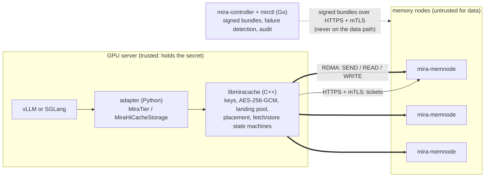
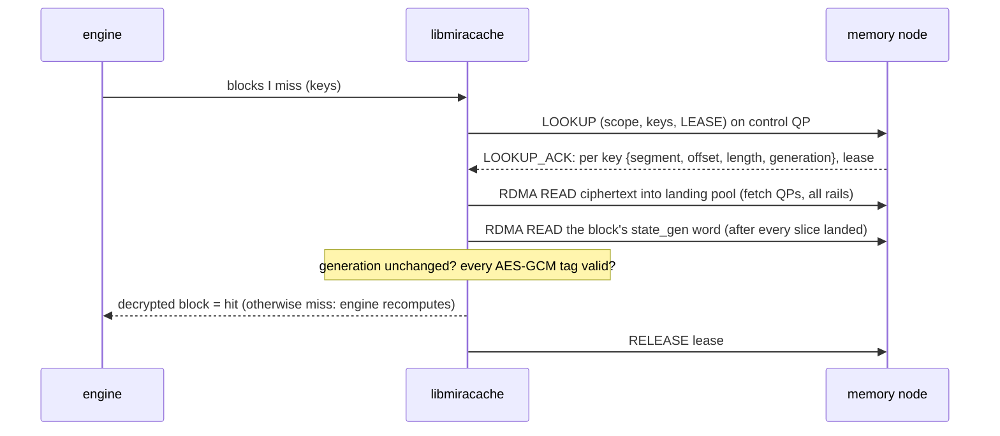
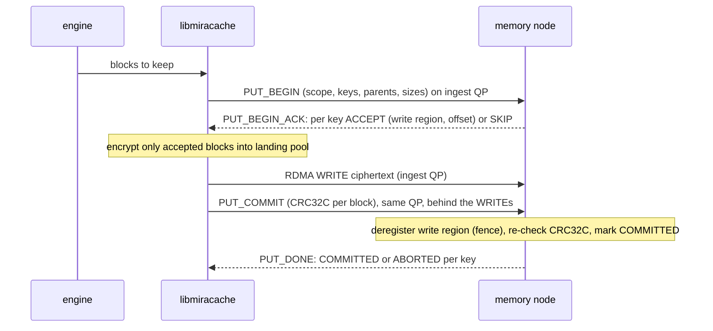

# miracache architecture

This page explains how miracache is built: its parts, what happens on a fetch and a store, where data is placed,
what happens when something fails, and how configuration changes while it runs.

> **Status: alpha.** Everything described here is built and tested end to end on software RDMA (soft-RoCE and
> soft-iWARP). Nothing has run on a hardware RDMA NIC yet, and no engine has served requests through miracache on a
> GPU yet. This page describes behaviour, not speed: it contains no performance figures.

Related pages: [protocol.md](protocol.md) (wire and storage formats), [security.md](security.md) (threat model),
[operations.md](operations.md) (install and run), [simulator.md](simulator.md) (the deterministic fault simulator).

## 1. The idea in one paragraph

An LLM engine keeps the attention state of a conversation, the **KV cache**, so that the next turn only processes the
new tokens. vLLM and SGLang already keep it in GPU memory (L1) and in the GPU server's own DRAM (L2). When both are
full, the engine evicts it and must later recompute it. miracache adds a third tier (L3): a pool of DRAM on other
servers, reached over RDMA. When the engine evicts a block, miracache encrypts it and stores it in the pool. When the
engine needs a block it no longer has, miracache looks it up, reads it back with a one-sided RDMA READ, verifies and
decrypts it, and hands it to the engine. If anything goes wrong, the answer is a cache miss and the engine recomputes,
exactly as it would without miracache.

## 2. Components

| Component | Language | What it does |
|---|---|---|
| `mira-memnode` | C++20 | The memory node. Stores encrypted KV blocks in pinned hugepage memory, answers lookups, grants leases, accepts stores, evicts, and serves an admin API (tickets, drain) and Prometheus metrics. It never holds a payload key and never decrypts anything. Runs unprivileged (only `CAP_IPC_LOCK`). |
| `libmiracache` | C++20, with a C ABI and a Python binding | The client library, loaded into the engine process. Derives keys, encrypts and decrypts, chooses the memory node for each block, manages RDMA connections and the landing pool, and runs the fetch and store state machines on its own I/O and crypto threads. Python calls never block on the network. |
| vLLM adapter (`MiraTier`) | Python | Plugs `libmiracache` into vLLM as a secondary tier of vLLM's offloading connector, through its tiering API. |
| SGLang adapter (`MiraHiCacheStorage`) | Python | Plugs `libmiracache` into SGLang as a HiCache storage backend, through the `dynamic` backend hook. |
| `mira-controller` | Go | Optional. Builds, signs and publishes the **cluster bundle** (membership and live configuration), detects failed memory nodes, and keeps a hash-chained audit log. Not on the data path. |
| `mirctl` | Go | Operator CLI: publish a bundle with or without a controller, add, drain and remove nodes, manage role bindings, generate signing keys and deployment secrets, verify the audit chain. |
| `mira-preflight` | Python | Checks an engine's flags and the host before launch, and hard-fails settings that would break caching or isolation. |
| `node_prep` | Python | Plans (dry run by default) and applies host setup: hugepages, the hugetlbfs mount, memlock limits. |
| `mira-nicprobe` | C++ | Lists RDMA devices, their capabilities and the matching NIC profile. |

**Plugging in without engine patches.** Both adapters use only public plug-in points and configuration flags; no
engine source is changed. This comes with conditions, which `mira-preflight` checks: specific engine flags must be set
(for example vLLM's `kv_load_failure_policy = recompute` and the `sha256_cbor` prefix hash, or SGLang's
`hicache_storage_pass_prefix_keys`), and the vLLM adapter reads one internal vLLM field. The adapter checks that field
at start-up and refuses to start on a vLLM version where it has changed shape; the engine then runs without L3.

## 3. Concepts

| Term | Meaning |
|---|---|
| **Block** | One unit of KV cache as the engine hands it over: a vLLM block, or one SGLang page (all layers). Stored as one encrypted object. |
| **Chain** | The blocks of one prompt prefix, in order. Each block names its parent; the first block is the **chain root**. |
| **Scope** | The server-side container for one chain. Its 32-byte `scope_id` is derived on the GPU host from the chain root and the deployment secret. |
| **Principal** | The identity a memory node accounts for: a named group of client certificate identities. Quotas and scope visibility are per principal. |
| **Deployment secret** | A 32-byte secret shared by every GPU host of one deployment, never sent to a memory node. All keys are derived from it. |
| **Rail** | One RDMA path: a (device, port, IP address). A host may have 1 to 4 rails. |
| **Lease** | A short promise from a memory node that the blocks it just reported will not be moved or overwritten while the client reads them (default 30 s, renewable). |
| **Ticket** | A single-use, random 128-bit value the client gets over mTLS and presents when it opens an RDMA connection. |
| **Bundle** | The signed, generation-numbered document that carries membership and live configuration (bundle mode). |

## 4. Inside a memory node

- **Store.** The cache lives in segment files on a hugetlbfs mount (4 GiB per segment by default; the example
  configuration uses 1 GiB), mapped shared and registered
  with the NIC. Because the memory belongs to the files and not to the process, **a restarted memory node keeps its
  cache**. Each segment is cut into 256 MiB runs, and each run into equal-size block slots; size classes are created on
  demand, since a deployment has few distinct block sizes.
- **Three owners per block.** Every stored block has three parts:

  | Part | Written by | Readable over RDMA? |
  |---|---|---|
  | `state_gen` word (8 bytes: state + generation) | memory node | yes, read-only, in one dense array |
  | server header (128 bytes: scope, keyed key hash, parent, chain position, lengths, CRCs) | memory node | **no**: private memory |
  | client extent (64-byte crypto header + ciphertext + tags) | client | yes, read-only; writable only during its own store |

  So anyone holding a fetch key can read ciphertext and state words, and nothing else: no scope IDs, no key hashes,
  no chain links.
- **Generations.** Every time a slot starts a new write it takes the next value of one node-wide, monotonic 56-bit
  counter, persisted across restarts. A (slot, generation) pair is never reused, so "same generation" always means
  "same store". This is what lets a client detect a block that changed under its read.
- **Index.** Scopes are keyed by **(principal, scope_id)**. Each scope holds its block map and the parent/child links.
- **Eviction.** Above 92 % occupancy the node evicts down to 88 % (both live settings). Order: expired scopes first,
  then principals over their cap (their own least recently used scope), then the globally coldest scope. Inside a
  scope it removes **leaves first, tail first**: a block with a live lease, a child, or a pending child store is never
  a victim, so a chain never loses its head while keeping its tail. A background scrubber re-checks CRCs.
- **Threads.** Lookup handling runs on shards pinned near the NIC; slow work (registering write regions, CRC32C)
  runs on separate ingest workers, so a store can never stall a lookup. On a fetch the payload never touches the memory
  node's CPU: the client reads it directly with RDMA.

## 5. Connections

Every client opens, per (memory node, rail), three classes of RDMA connection (RC queue pairs through `rdma_cm`):

| Class | Count | Carries | What the memory node exposes on it |
|---|---|---|---|
| control | 1 | lookups, leases, invalidations, keepalive, stats | nothing |
| fetch | per rail, from the NIC profile (1 to 8 in the shipped profiles) | client RDMA READs | segment data and the `state_gen` array, read-only |
| ingest | 1 | all store messages, client RDMA WRITEs | a short-lived write region per store batch |

Each class lives in its own protection domain on the memory node, so a fetch connection can never use a write key.
On the client, only the **landing pool** (a miracache-owned hugepage buffer, split per memory node and rail) is ever
registered with the NIC. Engine buffers are never exposed to RDMA. Connections are opened lazily on first use and closed
when idle; a keepalive runs every second, and a reconnect backs off exponentially with jitter behind a per-node circuit
breaker.

Only three RDMA operations are used, all supported by every RDMA driver on both RoCEv2 and iWARP: SEND/RECV (control
messages), READ (fetch) and WRITE (store). There is **no TCP fallback**: if RDMA is not available, preflight fails, and
at run time the engine simply recomputes.

**RoCEv2 and iWARP** share one code path. The protocol is detected per device (`protocol = "auto"`), with a one-line
override. The differences that matter are handled once: the client always sends the first message on every connection
(iWARP requires it), READ sinks are only the landing pool (iWARP needs remote-write permission on a READ sink), and no
step ever treats a WRITE completion as proof that data arrived (on iWARP it only means "handed to TCP").

## 6. Data path

### 6.1 Fetch

1. **Look up and lease.** The client sends LOOKUP to the memory node that owns the scope. For each key, the node
   answers HIT with the block's location and generation, or MISS. With the LEASE flag it also grants a lease.
2. **Read.** The client reads the ciphertext straight from the node's memory into its landing pool with RDMA READ,
   cut into slices (1 MiB by default) spread across fetch connections and rails.
3. **Sequence check.** Only after every slice of the block has landed, on every connection and rail, the client reads
   the block's 8-byte `state_gen` word again. Because the node changes that word before any byte of a block can change,
   and generations are never reused, an unchanged (COMMITTED, generation) proves the bytes were stable for the whole
   read.
4. **Authenticate and decrypt.** Every segment's AES-256-GCM tag must verify under the block key, with the expected
   scope, key and length bound in. The decrypt pass reads each ciphertext byte from the landing pool exactly once, so a
   hostile node that rewrites the buffer during decryption cannot slip unauthenticated bytes through.
5. **Result.**

   | Sequence check | Tags | Meaning | Result |
   |---|---|---|---|
   | changed | any | benign race (lease expired, block evicted) | miss |
   | unchanged | fail | a stable block does not authenticate: corruption or tampering | miss, security alert, the client invalidates the block and its subtree |
   | unchanged | pass | exactly the bytes that were stored | hit |

Every operation carries a deadline. On expiry the client reports a miss at once, then drains or errors the
connections before any buffer is reused: **no buffer is released or reused while a network operation that refers to it
is still outstanding.**

### 6.2 Store

1. **Ask for space.** PUT_BEGIN names the scope and, per key, its parent, chain position and stored length. The node
   answers ACCEPT with a place in a short-lived write region, or SKIP. SKIP covers "already stored", "being stored",
   "over quota", "no space" and "busy" alike, so a store reveals nothing about what else exists. A store is always
   optional: a node that is busy may skip it, and the engine loses nothing but a future hit.
2. **Encrypt only what was accepted**, computing a CRC32C of the ciphertext in the same pass. A SKIP costs no AES.
3. **Write** the ciphertext with RDMA WRITE.
4. **Commit on the same connection.** PUT_COMMIT travels on the same RC queue pair, behind the WRITEs. RC delivers in
   order, so the commit can only arrive after the data is placed, on RoCE and on iWARP alike.
5. **Fence and check.** The node deregisters the write region first, so no late write can land, then recomputes the
   CRC32C and compares. Only then does the block become COMMITTED and visible. A committed block is never modified.

Stores are idempotent: storing a key that already exists is a SKIP, counted as success. Only a store that carries a
chain root opens a new scope; a lookup never opens one.

## 7. Placement

**One chain lives on one node.** The owner of a scope is chosen by **weighted rendezvous hashing** on the `scope_id`:
every client computes, for each memory node, a score from a hash of (scope ID, node ID) and the node's weight, and the
highest score wins. The exact function is in [protocol.md](protocol.md#9-placement). Consequences:

- No placement server and no per-object metadata lookup: every client computes the same answer on its own.
- A new node takes about 1/(N+1) of new chains, and **nothing is moved** when it joins: existing chains keep extending
  where they live. A lookup tries the current owner, then the owner under the previous membership. A chain found under
  neither after two membership changes is a miss: the engine recomputes it once and it re-roots on the current owner.
- Losing one node costs about 1/N of the cache.
- **Optional replicas** (`placement.replicas`, 1 to 3, default 1): each scope is written to the first R nodes of its
  placement order, in distinct zones if nodes are labelled with zones. Replicas are written by the client, best effort,
  and not repaired after a failure. With two copies, losing a memory node no longer loses its share of the cache.

## 8. Membership: two modes

| | Static mode | Bundle mode |
|---|---|---|
| Node list | fixed list in each `client.toml` | signed cluster bundle |
| Principals and roles | in each `memnode.toml` | in the bundle (separately signed security part) |
| Controller | none | `mira-controller`, or `mirctl bundle publish` with no controller |
| Live client config | no (restart the engine to change it) | yes |
| Failure detection | each client's circuit breaker | the controller removes failed nodes |

**Bundles** are Ed25519-signed and carry one strictly increasing generation. A node or client accepts a bundle only
if both signatures verify, each signing key holds the right role, and the generation is higher than the highest it has
persisted, so an old bundle cannot be replayed. Memory nodes relay the bundle; clients pull it from the memory nodes'
admin APIs. The operator writes only intent (which nodes, weights, zones, principals, roles, config); node IDs,
hostnames and rails are learned from the nodes themselves.

**Identities are computed, never typed.** Each memory node draws a random ID on first start and keeps it in its state
directory (`[node] state_dir`, file `node-id`). The client learns it from the node (in the connection handshake and the
ticket answer). A node keeps its ID across restarts, reboots and a wiped store; replacing a node means deleting its
`node-id` file, and the next start draws a new one. Every log line and metric about a memory node carries its ID,
hostname and IP address.

**Failure detection follows the RDMA fabric, not just the management network.** In bundle mode with a controller,
the controller polls every node's health, including the state of each RDMA rail, once a second, and clients report
which nodes they can reach. Over the failure timeout (default 10 s), the controller removes a node only if (a) its
health poll fails **and** no client reports a working rail to it, (b) it reports every rail down, or (c) at least half
of its clients (and at least 2 distinct identities) cannot reach it while still reaching others. It removes at most one third of the nodes per window without
an operator's confirmation, so losing a switch cannot empty the cluster.

## 9. Failure handling

The rule everywhere: **every failure degrades to "the engine recomputes", never to wrong data or a request error.**

| Failure | Effect | Recovery |
|---|---|---|
| Memory node process crash | in-flight fetches miss; about 1/N of sessions lose L3 until it is back | restart keeps the cache and the same node ID |
| Memory node reboot or wiped store | its own 1/N of the cache is cold | the node formats a blank store under the same ID |
| Memory node lost for good | about 1/N of the cache is gone (unless replicas are on) | removed after the failure timeout (default 10 s); chains re-root on the new owners |
| GPU server or engine crash | leases released, unfinished stores fenced and aborted | nothing to repair: the session's KV is still in the pool, so the GPU it moves to can fetch it |
| One rail fails | slices are re-issued on other rails if the lease and deadline allow | the rail reconnects with backoff |
| All rails to a node fail | fetches to that node miss fast (circuit breaker) | removed after the timeout until it returns |
| Slow memory node | outlier detection opens that node's breaker | operator drains it or lowers its weight |
| Controller down | **no effect on the data path**; joins, removals and config changes wait | restart it; it can rebuild its state from a node's current bundle |
| AEAD failure on a stable block | a miss and a security alert | the client invalidates the block and its subtree |
| Store checksum mismatch at commit | that store aborts | counted; alert if it persists |
| Clock jump | none: only monotonic clocks are used on the data path | none |

## 10. Live configuration and upgrades

- **Live settings.** On a memory node, leases, tickets, limits, quotas, retention, eviction and scrubbing change
  without a restart: from the bundle in bundle mode, or by editing `memnode.toml` and sending `SIGHUP` in static mode.
  Certificates and keys are re-read too. A new snapshot is validated first and swapped atomically; an operation uses
  the values current when it started, and granted leases keep their expiry. A bad new value rejects the whole reload
  and the old snapshot stays.
- **Client.** In bundle mode, connection timings, slice size, store deadline, replica mode, circuit-breaker settings
  and crypto workers change live; some transport settings are recorded and applied at the next planned reconnect. The
  client also re-reads its TLS files and the deployment secret file when they change. A client in static mode is
  restarted to change its configuration.
- **Static settings.** A short list (store layout and size, node identity and rails, trust file path, thread slots)
  changes only by a rolling restart, one node at a time. Clients see misses, never errors.
- **Drain.** On `SIGTERM` a memory node sends GOAWAY to its clients and keeps serving for `node.drain_ms` (default
  5 s) or until no work is left, then stops. Clients move to other nodes and treat the gap as misses.
- **Upgrades.** Memory nodes first, then clients. A memory node accepts the current and the previous major wire
  version, and new optional fields are ignored by older peers (see [protocol.md](protocol.md#10-versioning)).

## 11. Limits of this version

- Pipeline parallelism and vLLM context parallelism must be 1. SGLang page size must be at least 16 (64 recommended).
- Quotas are per principal, which in practice means per deployment: there are no per-user quotas.
- Replicas are best effort and client-written; there is no repair after a failure. miracache is a cache, not a
  database.
- One controller per cluster, with a local file store; the data path does not depend on it.
- No TCP transport, no InfiniBand support.
